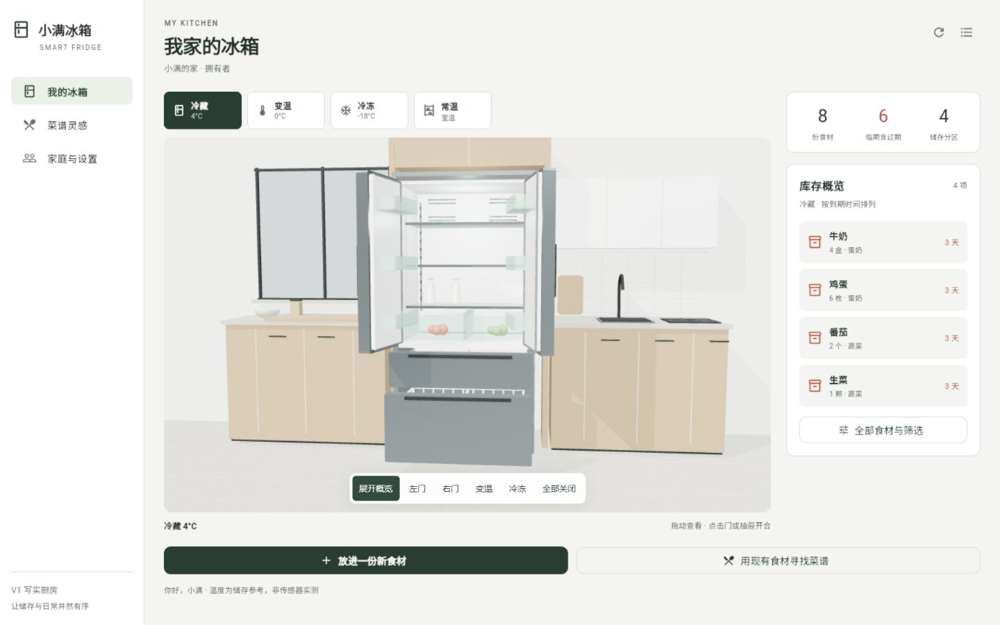
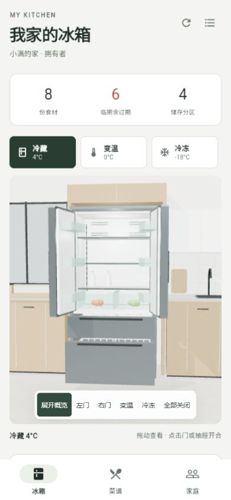

# V1 写实厨房实现与验收

日期：2026-10-31。当前视觉与结构基线为 V1.4，替代旧版 WebGL 香槟复古风格。

业务交互以最新[全仓审查复验](../../reviews/2026-10-31-full-code-api-audit.md)为准。原视觉阶段漏测了 iframe 上方的普通鼠标输入及手机底栏遮挡，现已修复，并完成桌面与手机实际新增、临期筛选返回、家庭及设置按钮复验。

## 设计依据

- [V1 冰箱外观与内部结构](fridge-concept-v1.png)、[PSD](fridge-concept-v1.psd)
- [V1 厨房场景](fridge-kitchen-v1.png)、[PSD](fridge-kitchen-v1.psd)
- [设计与交互规范](../../superpowers/specs/2026-10-31-realistic-kitchen-ui.md)
- [开发设计说明 V1.4](../../../可视化冰箱APP开发设计说明-V1.4.docx)

概念图与单图层 PSD 用作外观参考。实际 Web 首页使用 Three.js 实时几何、程序化材质和当前家庭库存，不将概念照片当作实时场景。现阶段食材模型和材质仍为简化实现，摄影级细节属于后续资产优化范围。

## 实际浏览器截图

桌面 1440 × 900：

手机 390 × 844：

其他场景：[关门](implementation/desktop-closed.png)、[厨房常温区](implementation/desktop-pantry.png)、[真实空冰箱](implementation/mobile-empty.png)、[筛选清单](implementation/mobile-filter.png)、[登录页](implementation/desktop-login.png)。

最终构建恢复默认 1280 × 720 视口的截图：[最终首页](implementation/desktop-final.png)。页面可纵向滚动访问下方操作；最终控制台检查无新增 error。

## 本轮检查

| 项目 | 结果与证据 |
| --- | --- |
| 实际结构 | 双门共用冷藏室；三层玻璃搁板、双保鲜盒、内胆与门内瓶架；独立变温托盘与双层冷冻篮 |
| 门和抽屉 | 侧铰链转动、滑轨平移；全部关闭后单门与单抽屉可组合开启 |
| 常温语义 | 储物位置位于厨房侧柜台，选择常温不打开冷藏门 |
| 响应式 | 桌面侧导航与库存侧栏；390 像素页面完整展示冰箱，清单和操作可滚动到达 |
| 真实快照 | 四区共 8 条记录进入场景；切至空冰箱为 0，切回恢复 8；空库存不注入演示食材 |
| 筛选隔离 | 手机筛选“牛奶”返回 1 条，场景保持完整 8 条库存 |
| 消息与边界 | 同源、父窗口/iframe 来源校验；忽略无效 JSON；库存消息不携带会话令牌 |
| 回归 | Flutter 53 项通过；结构/状态 4 项通过；家庭工作区 30、组合筛选 25 个真实 Gateway 断言通过 |
| 文档 | V1.4 Word 以本机 Word 导出 PDF，再以 Poppler 渲染；8 页逐页检查通过 |

详细审查、最终构建结果及范围限制见 [阶段审查](../../reviews/2026-10-31-realistic-ui.md)。本轮未重跑 Android APK 和 Maven 全模块测试；历史记录不得替代本轮结果。
