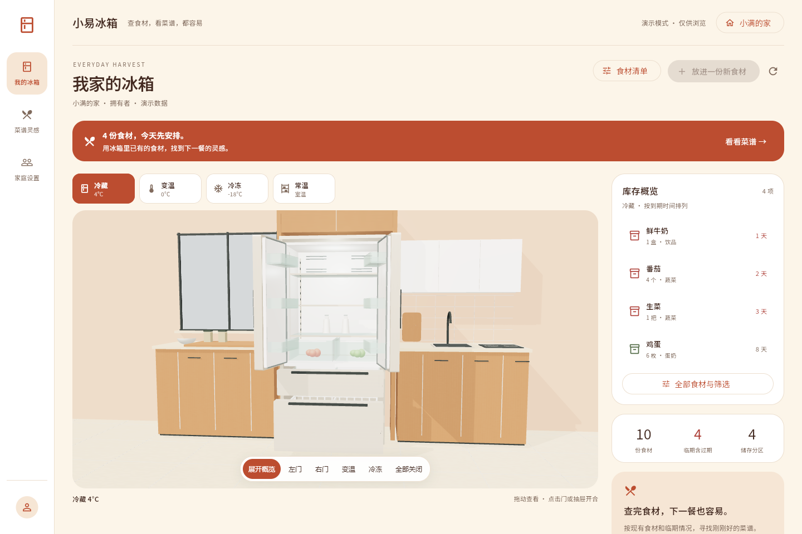
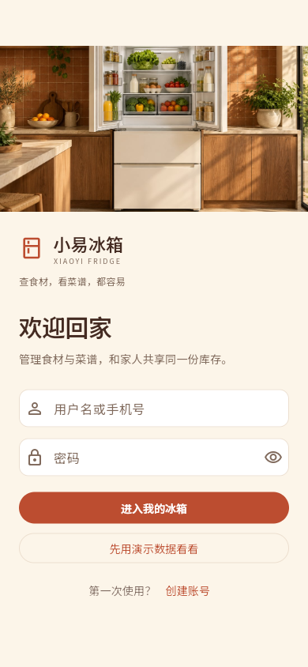
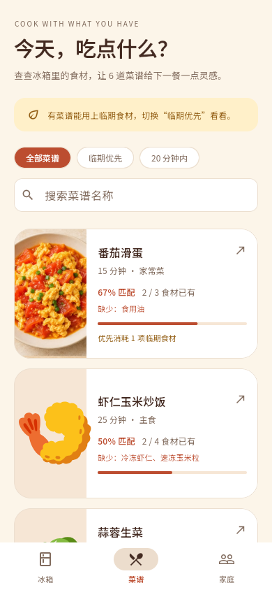

# 小易冰箱 · 暖橙食集实际界面

日期：2026-10-31。选定 C「暖橙食集」并完成当前前端实现。口号：查食材，看菜谱，都容易。

以下为运行中的 release Web 与运营端实际截图，取代概念稿作为本次实现的视觉验收依据。首页/菜谱最终采集使用已标记的演示会话；真实 Gateway 写入、家庭切换与只读权限证据另列。

| 界面 | 证据 |
| --- | --- |
| 用户端手机登录 | [最终截图](../../reviews/evidence/2026-10-31-warm-harvest/app-mobile-login-final.png) |
| 用户端桌面首页 | [最终截图](../../reviews/evidence/2026-10-31-warm-harvest/app-desktop-home-final.png) |
| 用户端手机首页 | [最终截图](../../reviews/evidence/2026-10-31-warm-harvest/app-mobile-home-final.png) |
| 用户端手机菜谱 | [最终截图](../../reviews/evidence/2026-10-31-warm-harvest/app-mobile-recipes-final.png) |
| 真实账号桌面工作区 | [截图](../../reviews/evidence/2026-10-31-warm-harvest/app-desktop-final.png) |
| 家庭与设置 | [桌面](../../reviews/evidence/2026-10-31-warm-harvest/app-desktop-family.png)、[手机](../../reviews/evidence/2026-10-31-warm-harvest/app-mobile-family.png) |
| 食材写入与草稿 | [桌面成功](../../reviews/evidence/2026-10-31-warm-harvest/app-desktop-add-success.png)、[手机成功](../../reviews/evidence/2026-10-31-warm-harvest/app-mobile-add-success.png)、[关闭确认](../../reviews/evidence/2026-10-31-warm-harvest/app-mobile-draft-confirm.png) |
| 家庭隔离、只读 | [空工作区](../../reviews/evidence/2026-10-31-warm-harvest/app-mobile-empty-family.png)、[只读者最终界面](../../reviews/evidence/2026-10-31-warm-harvest/app-mobile-viewer-final.png) |
| 运营端 | [登录](../../reviews/evidence/2026-10-31-warm-harvest/admin-login.png)、[看板](../../reviews/evidence/2026-10-31-warm-harvest/admin-dashboard-final.png)、[菜谱](../../reviews/evidence/2026-10-31-warm-harvest/admin-recipes-final.png)、[库存](../../reviews/evidence/2026-10-31-warm-harvest/admin-products-final.png)、[订单](../../reviews/evidence/2026-10-31-warm-harvest/admin-orders-final.png)、[手机订单](../../reviews/evidence/2026-10-31-warm-harvest/admin-mobile-orders.png) |

已检查桌面 1440 × 960 和手机 390 × 844 的实际页面、根弹层和导航；运营订单页另检查 320/390/1024/1440 宽。最终中文按钮使用本地字体，未观察到缺字；早期未带 `final` 的截图记录了迭代过程，不应用作最终字体效果。

三维场景延续实时几何模型，使用暖木/奶油配色，门、抽屉和食材仍能交互。概念照片的真实摄影细节不是此几何模型的渲染质量。Android 使用明示的参考图和真实清单，本轮尚未进行 Android 真机及实际 GPU 性能验收。

验收方法、回归测试、阶段审查及未完成项见 [完整记录](../../reviews/2026-10-31-warm-harvest-xiaoyi.md)。三版概念稿保留在 [选稿历史](../ui-redesign-2026-10-31/审查说明.md)。
