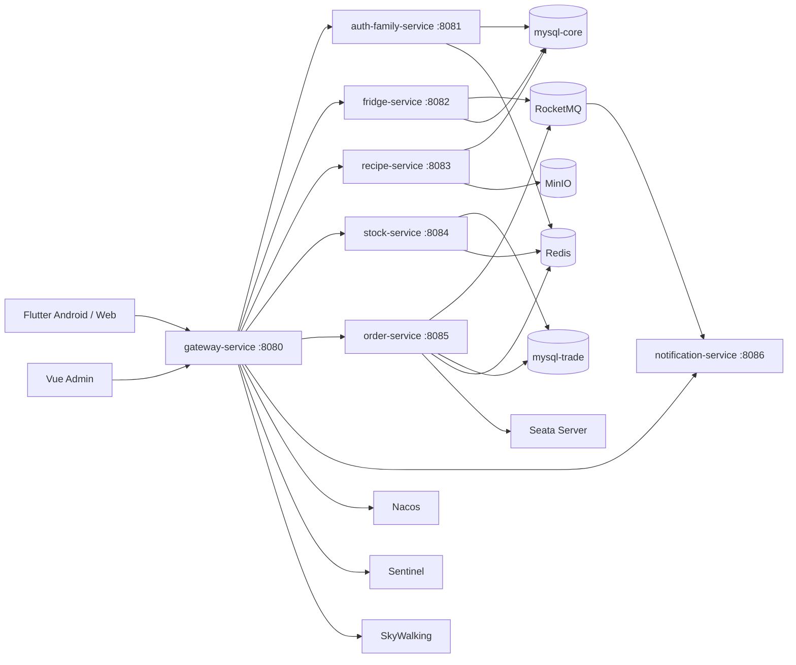

# Smart Fridge 工程设计

## 1. 决策与边界

V1.3《可视化冰箱APP开发说明》是本项目的产品、视觉与验收基线，V1.2 保留为历史记录。项目所有者和实施方由同一人承担，因此不再把合同签署或外部协作权限作为开发前置条件。验收指标中依赖硬件或数据模型的参数全部配置化，默认值用于本机开发与自动测试，最终演示时按验收环境覆盖。

项目采用模块化单仓库，交付物分为：

- Flutter Android/Web 用户端。
- Vue 3 运营管理端。
- 7 个基于 Spring Boot 3.2 的 Java 服务。
- MySQL、Redis、Nacos、MinIO、Sentinel、Seata、RocketMQ、SkyWalking 的 Compose 编排。
- OpenAPI、SQL、架构、测试和演示证据文档。

## 2. 架构原则

- Gateway 是客户端唯一入口。Flutter 和管理端不直接调用业务服务端口。
- 服务按业务域拆分，共享代码只包含协议、安全、Web 基础设施等稳定能力。
- 控制层只处理 HTTP 映射与参数校验；业务规则位于应用服务；数据访问位于仓储层。
- MySQL 是权威数据源，Redis 只用于会话撤销、缓存、幂等和短期锁。
- 跨订单事务使用 Seata AT；通知和实时刷新使用 RocketMQ 事件。
- 所有对外响应使用 `code/message/data/traceId`，所有写操作携带可观测的请求标识。
- 云模式使用 Nacos 注册与配置；local 模式关闭外部注册，保证新开发者先能启动单服务。

## 3. 服务边界

| 模块 | 端口 | 第一轮职责 | 后续职责 |
| --- | ---: | --- | --- |
| gateway-service | 8080 | 路由、CORS、健康检查、请求追踪 | JWT 前置校验、限流和熔断 |
| auth-family-service | 8081 | 注册、登录、刷新、退出、家庭创建 | 邀请、角色和成员治理 |
| fridge-service | 8082 | 健康骨架、冰箱领域协议 | 结构、食材、临期、时间线与实时事件 |
| recipe-service | 8083 | 健康骨架、菜谱领域协议 | 推荐、详情、做饭扣减与互动 |
| stock-service | 8084 | 健康骨架、库存领域协议 | SKU、库存乐观锁和 Seata 分支事务 |
| order-service | 8085 | 健康骨架、订单领域协议 | 补货订单、优惠券、支付和全局事务 |
| notification-service | 8086 | 健康骨架、通知领域协议 | MQ 消费、站内信和 WebSocket 推送 |
| common-core | - | 响应模型、错误处理、追踪标识 | 稳定通用基础设施 |

## 4. API 与安全

- 统一前缀 `/api/v1`。
- 认证接口：`POST /api/v1/auth/register`、`login`、`refresh`、`logout`。
- 家庭接口：`POST/GET /api/v1/families`。
- 业务接口由 Gateway 路由至对应服务。
- 登录成功返回短期 access token 与长期 refresh token。access token 默认 30 分钟；refresh token 默认 7 天。
- 登出时将 access token 的 `jti` 写入 Redis 黑名单，TTL 与令牌剩余时间一致。
- 密码使用 BCrypt。用户名和手机号至少提供一个，二者均唯一。
- 家庭角色固定为 `OWNER`、`EDITOR`、`VIEWER`；每次写操作在服务端重新校验，不依赖前端按钮状态。

## 5. 数据设计

首个纵切只落账号、家庭和成员关系：

- `app_user`：账号、密码摘要、状态和审计时间。
- `family`：名称、邀请码、拥有者和审计时间。
- `family_member`：家庭、用户、角色和加入时间。
- `refresh_session`：刷新令牌标识、用户、过期时间和撤销状态。

数据库结构由 Flyway 版本化。跨领域表在各自 schema 内维护，禁止跨 schema 直接写表。

## 6. 用户端

- `core`：配置、网络、路由、主题和会话。
- `features`：auth、fridge、recipe、trade、notification。
- 首屏使用香槟米色 WebGL 真 3D 四门立式冰箱；French door、变温抽屉、冷冻抽屉、PBR 材质和场景灯光均由 Three.js 实时渲染。
- Flutter Web 与业务数据负责响应式外壳、导航、分区切换、可访问控件和详情面板；3D 场景通过同源 iframe 嵌入，不依赖 CDN。
- 3D 视口支持拖动环绕、射线拾取、门体开合和抽屉滑出；场景状态回传 Flutter 当前分区。
- 所有核心控件提供 Semantics 标签；图片失败时展示文字占位，并允许切换表格视图。
- 本阶段先完成登录/注册、会话安全存储、首页壳和演示数据下的 WebGL 真 3D 冰箱视图；Android 保留同数据降级视图，Web 作为 3D 验收路径。

### 6.1 WebGL 3D 场景

- Three.js r180 运行文件固定在 `apps/fridge-app/web/vendor`，许可证同目录保存，不从 CDN 加载。
- `fridge3d/index.html` 作为同源 3D 视口，通过 iframe 嵌入 Flutter；Flutter 与场景使用 JSON `postMessage` 双向同步区域状态。
- 冰箱由实时几何创建：上方两扇 French door、中部变温抽屉、下部冷冻抽屉、拉丝金属外壳、深可可色把手、内部层架和食材模型。
- 支持拖拽环绕、射线拾取、门铰链开合和抽屉滑轨动画；动画只由离散状态驱动，刷新后不依赖随机时序。
- 场景启用 PBR 环境光照、软阴影、局部内腔照明和程序化拉丝纹理；像素比上限为 2，阴影贴图上限为 2048。
- WebGL 不可用、模块加载失败或浏览器关闭硬件加速时，场景显示可读错误态；Flutter 保留表格清单作为功能降级路径。

### 6.2 视觉基准

- Figma 概念文件：`https://www.figma.com/design/dBXCo4YNTagNNs5cnvONEq`。
- 仓库内基准图：`docs/design/webgl-concepts/01-home-closed.jpg`、`02-left-door-open.jpg`、`03-drawer-open.jpg`、`04-mobile-closed.jpg`。
- 视觉采用香槟米色拉丝金属、深可可色文字与把手、鼠尾草绿运行状态和陶土红临期提示；不采用需求来源帖子的视觉版式。
- 桌面使用左侧导航、中央 3D 舞台和右侧状态栏；移动端保留底栏，冰箱保持首屏第一视觉。

## 7. 管理端

- 登录页、仪表盘布局、侧栏和头部状态。
- API 地址来自 `VITE_API_BASE_URL`，开发环境默认经 Gateway 访问。
- 首轮以可运行的仪表盘和导航骨架为主，业务表格使用真实 API 契约替换演示数据。
- 页面按功能域拆分路由和 API 模块，避免单文件堆积。

## 8. 基础设施与验证

- `compose.core.yml`：Nacos、MySQL、Redis、MinIO。
- `compose.full.yml`：在 core 上增加 RocketMQ、Seata、Sentinel、SkyWalking。
- Compose 只为基础设施提供服务；Java 服务可在本机运行，后续再补容器镜像。
- 所有镜像固定明确版本，不依赖 `latest`。
- 配置从环境变量读取，仓库只提交 `.env.example`。

## 9. 测试策略

- 后端：common-core 单元测试、认证服务 Web 层与仓储集成测试、Maven 全模块编译。
- Flutter：模型和会话单元测试、核心 Widget 测试、`flutter analyze`。
- 管理端：类型检查、生产构建。
- Compose：`docker compose config` 静态校验。
- CI：PR 与 main 执行后端测试、Flutter 检查和 Web 构建。

## 10. 阶段计划

1. S0/S1：设计基线、工程骨架、Compose core、认证家庭纵切、Flutter/管理端壳。
2. S2：冰箱分层视图、食材增删改查、3D 食材模型与信息标签、降级表格。
3. S3：家庭同步、时间线、菜谱推荐和做饭扣减。
4. S4：补货、优惠券、订单、Seata 与 Sentinel。
5. S5：RocketMQ 通知、SkyWalking、完整体检、发布包和演示材料。

每个阶段以验收编号关联自动化测试或可复现演示。AC-01、AC-02、AC-14 的部分能力和 K-01、K-02、K-06 的工程证据在第一阶段落地；其余编号按阶段推进。
