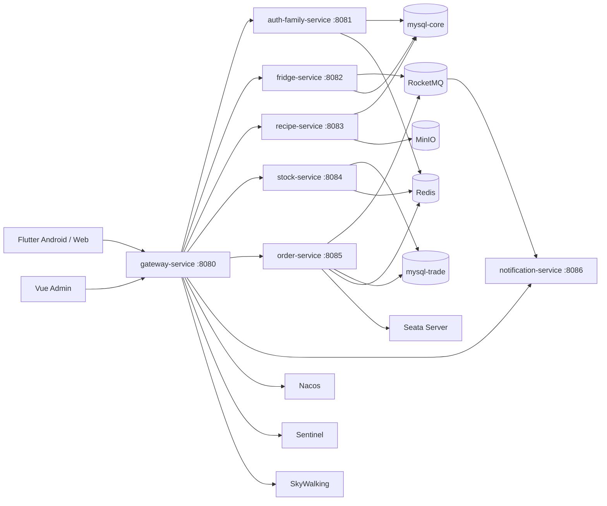

# Smart Fridge 工程设计

## 1. 决策与边界

V1.4《可视化冰箱APP开发设计说明》是当前视觉与前端设计基线，采用 2026-10-31 确认的 V1 写实厨房与冰箱；业务规则沿用已实现接口与 V1.3 功能条款。V1.3 及更早版本的香槟复古视觉已被替代，保留文件用于历史追踪。项目所有者和实施方由同一人承担，因此不再把合同签署或外部协作权限作为开发前置条件。验收指标中依赖硬件或数据模型的参数全部配置化，默认值用于本机开发与自动测试，最终演示时按验收环境覆盖。

项目采用模块化单仓库，交付物分为：

- Flutter Android/Web 用户端。
- Vue 3 运营管理端。
- 7 个基于 Spring Boot 3.2 的 Java 服务。
- MySQL、Redis、Nacos、MinIO、Sentinel、Seata、RocketMQ、SkyWalking 的 Compose 编排。
- OpenAPI、SQL、架构、测试和演示证据文档。

## 2. 架构原则

- Gateway 是客户端唯一入口。Flutter 和管理端不直接调用业务服务端口。
- 服务按业务域拆分，共享代码只包含协议、安全、Web 基础设施等稳定能力。
- 控制层只处理 HTTP 映射与参数校验；业务规则位于应用服务；数据访问位于仓储层。
- MySQL 是权威数据源，Redis 只用于会话撤销、缓存、幂等和短期锁。
- 跨订单事务使用 Seata AT；通知和实时刷新使用 RocketMQ 事件。
- 所有对外响应使用 `code/message/data/traceId`，所有写操作携带可观测的请求标识。
- 云模式使用 Nacos 注册与配置；local 模式关闭外部注册，保证新开发者先能启动单服务。

## 3. 服务边界

| 模块 | 端口 | 第一轮职责 | 后续职责 |
| --- | ---: | --- | --- |
| gateway-service | 8080 | 路由、CORS、健康检查、请求追踪 | JWT 前置校验、限流和熔断 |
| auth-family-service | 8081 | 注册、登录、刷新、退出、家庭创建 | 邀请、角色和成员治理 |
| fridge-service | 8082 | 健康骨架、冰箱领域协议 | 结构、食材、临期、时间线与实时事件 |
| recipe-service | 8083 | 健康骨架、菜谱领域协议 | 推荐、详情、做饭扣减与互动 |
| stock-service | 8084 | 健康骨架、库存领域协议 | SKU、库存乐观锁和 Seata 分支事务 |
| order-service | 8085 | 健康骨架、订单领域协议 | 补货订单、优惠券、支付和全局事务 |
| notification-service | 8086 | 健康骨架、通知领域协议 | MQ 消费、站内信和 WebSocket 推送 |
| common-core | - | 响应模型、错误处理、追踪标识 | 稳定通用基础设施 |

## 4. API 与安全

- 统一前缀 `/api/v1`。
- 认证接口：`POST /api/v1/auth/register`、`login`、`refresh`、`logout`。
- 家庭接口：`POST/GET /api/v1/families`。
- 业务接口由 Gateway 路由至对应服务。
- 登录成功返回短期 access token 与长期 refresh token。access token 默认 30 分钟；refresh token 默认 7 天。
- 登出时将 access token 的 `jti` 写入 Redis 黑名单，TTL 与令牌剩余时间一致。
- 密码使用 BCrypt。用户名和手机号至少提供一个，二者均唯一。
- 家庭角色固定为 `OWNER`、`EDITOR`、`VIEWER`；每次写操作在服务端重新校验，不依赖前端按钮状态。

## 5. 数据设计

首个纵切只落账号、家庭和成员关系：

- `app_user`：账号、密码摘要、状态和审计时间。
- `family`：名称、邀请码、拥有者和审计时间。
- `family_member`：家庭、用户、角色和加入时间。
- `refresh_session`：刷新令牌标识、用户、过期时间和撤销状态。

数据库结构由 Flyway 版本化。跨领域表在各自 schema 内维护，禁止跨 schema 直接写表。

## 6. 用户端

- Flutter Android/Web 用户端采用白色、石材灰、深灰文字与绿色操作强调，厨房中的木色和银色不锈钢构成主视觉。
- `core` 负责配置、网络、路由、主题和会话，`features` 保留账号、家庭、冰箱、菜谱与后续交易领域边界。
- 首页由真实冰箱名称、当前家庭/角色、分区选择、实时厨房、库存摘要与分区食材清单组成；移除硬编码菜谱匹配百分比与装饰贴纸。
- 现有登录、注册、会话续期、家庭治理、选择持久化、创建冰箱、食材操作和组合筛选保持原契约，不以视觉动画替代写入成功。
- 侧导航在窗口宽度 1120 px 及以上显示；首页可用内容宽度达到 960 px 时使用模型与库存双栏，否则上下排列。移动端使用底部导航，模型视口高 420 px。
- 图片只用于登录外观参考和非 Web 兼容视图；Web 首页的冰箱、厨房、门、抽屉、层架及食材均为可交互实时几何。

### 6.1 实时模型与厨房

- Three.js 运行文件继续固定在 `apps/fridge-app/web/vendor`，许可证同目录保留，不从 CDN 加载。
- 模型模块拆为 `fridge-model.js`、`kitchen-scene.js`、`fridge-state.js` 与 `fridge3d.js`，分别负责几何、环境、可测试状态和渲染交互。
- 冰箱约按 900 × 1850 × 720 mm 比例建立开放壳体，具有三层玻璃层架、双保鲜盒、六个门侧瓶架、灰色密封条、后部风道和层架导轨。
- 左右上部门共同属于冷藏室；中部为浅变温抽屉，下部为双层篮冷冻抽屉；常温食品位于厨房柜台，禁止将右侧冷藏门标为常温区。
- 视图默认展开，允许独立开合部件，支持全部关闭和概览复位。与旧版互斥开门不同，新版允许门与抽屉同时打开。拖动限制在安全观察角度内，降低动态效果偏好下跳过渐进动画。
- 木纹和拉丝纹理使用确定性程序生成，厨房具有木色橱柜、石材台面、窗户、地砖、水槽和灯光。像素比上限 1.75，阴影贴图上限 2048。

### 6.2 数据与消息边界

- Flutter 通过同源 iframe 嵌入场景；入口与模块使用 `rev=realistic-v1.4`，避免旧场景缓存与新 Flutter 界面混用。
- `ready`/load 握手后发送当前库存，后续快照变化重新同步。父页面检查 origin、来源窗口、JSON 格式和消息类型；场景只接受父窗口的同源命令。
- 库存消息仅包含食材 ID、名称、分类、数量和分区，不向 iframe 传递账号令牌。空库存清除食材几何；每区最多展示 12 条简化几何记录，清单保留全部数据。
- 模型选择回传分区，父页面避免重复反馈；常温选择只关注厨房柜台，不打开冷藏门。筛选结果独立于完整库存，不能替换三维快照。
- WebGL 故障显示明确提示，并保留食材清单。非 Web 客户端显示标注清楚的 V1 外观参考图，不宣称其展示实时库存。

### 6.3 当前视觉基线

- 当前概念与 PSD：`docs/design/realistic-fridge/fridge-concept-v1.*`、`fridge-kitchen-v1.*`。
- 当前页面与建模规范：[V1 写实厨房重构](2026-10-31-realistic-kitchen-ui.md)。
- V1.4 Word 说明：[可视化冰箱APP开发设计说明](../../../可视化冰箱APP开发设计说明-V1.4.docx)。
- 旧 Figma 文件与 `docs/design/webgl-concepts` 只作为历史材料，不再作为现行颜色、布局或冰箱结构验收标准。

## 7. 管理端

- 登录页、仪表盘布局、侧栏和头部状态。
- API 地址来自 `VITE_API_BASE_URL`，开发环境默认经 Gateway 访问。
- 首轮以可运行的仪表盘和导航骨架为主，业务表格使用真实 API 契约替换演示数据。
- 页面按功能域拆分路由和 API 模块，避免单文件堆积。

## 8. 基础设施与验证

- `compose.core.yml`：Nacos、MySQL、Redis、MinIO。
- `compose.full.yml`：在 core 上增加 RocketMQ、Seata、Sentinel、SkyWalking。
- Compose 只为基础设施提供服务；Java 服务可在本机运行，后续再补容器镜像。
- 所有镜像固定明确版本，不依赖 `latest`。
- 配置从环境变量读取，仓库只提交 `.env.example`。

## 9. 测试策略

- 后端：common-core 单元测试、认证服务 Web 层与仓储集成测试、Maven 全模块编译。
- Flutter：模型和会话单元测试、核心 Widget 测试、`flutter analyze`。
- 管理端：类型检查、生产构建。
- Compose：`docker compose config` 静态校验。
- CI：PR 与 main 执行后端测试、Flutter 检查和 Web 构建。

## 10. 阶段计划

1. S0/S1：设计基线、工程骨架、Compose core、认证家庭纵切、Flutter/管理端壳。
2. S2：冰箱分层视图、食材增删改查、3D 食材模型与信息标签、降级表格。
3. S3：家庭同步、时间线、菜谱推荐和做饭扣减。
4. S4：补货、优惠券、订单、Seata 与 Sentinel。
5. S5：RocketMQ 通知、SkyWalking、完整体检、发布包和演示材料。

每个阶段以验收编号关联自动化测试或可复现演示。AC-01、AC-02、AC-14 的部分能力和 K-01、K-02、K-06 的工程证据在第一阶段落地；其余编号按阶段推进。
