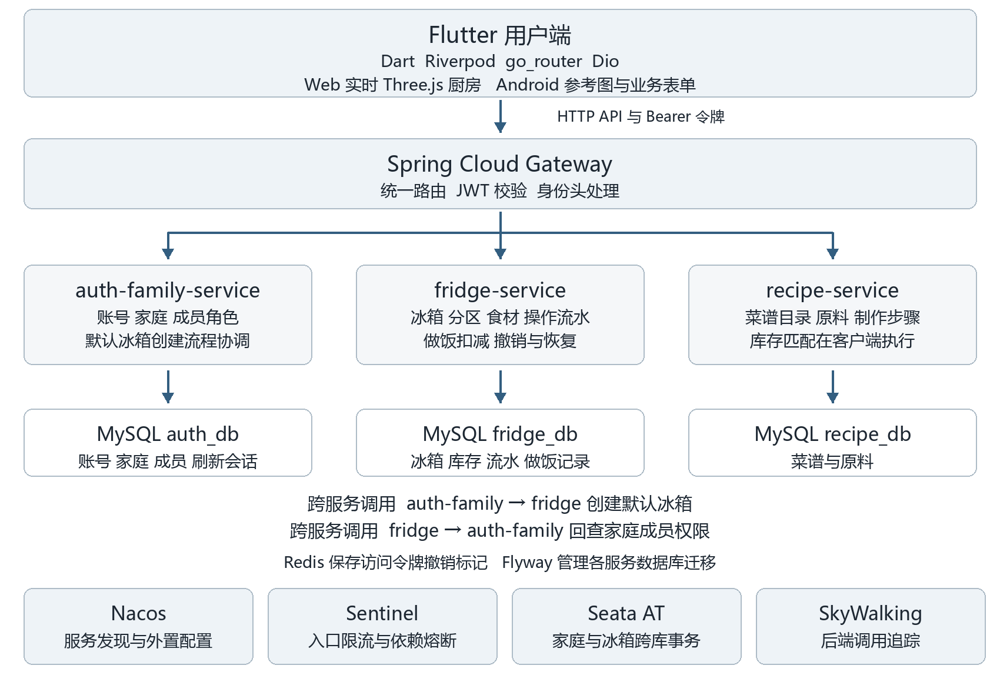

# 小易冰箱技术使用说明与答辩问答

答辩准备资料 2026年11月10日

小易冰箱面向共同管理食材的家庭，提供食材入库、临期查看、家庭协作、菜谱匹配、做饭扣减和操作撤销。答辩时，建议用“创建家庭并自动获得默认冰箱”解释微服务协作，再用“按菜谱做饭并扣减食材”展示业务闭环。

本资料按《微服务技术与项目开发实践 个人项目评分标准》的评分项整理，包含技术用途与实现要点、整体架构和模块关系、50道可能提问及回答要点、8分钟演示路线和代码查阅位置。问题是根据评分项推演的备考题，并非老师已公布的原题。

## 一分钟开场

“我的作品叫小易冰箱，主要解决一家人不知道冰箱里有什么、哪些食材快过期，以及现有食材能做什么的问题。用户可以创建或加入家庭，在可视化冰箱中管理食材，按库存匹配菜谱，做饭后扣减数量，并查看或撤销操作。

用户端使用Flutter，Web端用Three.js展示可交互的三维厨房。后端按账号家庭、冰箱食材和菜谱拆分为三个业务服务，由Gateway统一接入。创建家庭时，Nacos和Feign完成服务发现与调用，Sentinel保护入口和下游，Seata AT协调家庭与冰箱的跨库写入，SkyWalking用于观察调用链。

目前正式业务已完成本机Web验收。Android安装包可以构建，真机验收仍待完成。接下来我演示创建家庭、食材入库、做饭扣减和操作恢复。”

## 先记住这些事实

- 正式日常后端是4个应用：gateway、auth-family、fridge、recipe，其中3个是业务服务。Maven另外保留order、stock历史示例及公共模块。
- Web使用实时Three.js三维场景；Android当前使用参考图，不能说两端具有相同的三维交互。
- 菜谱推荐是规则匹配。正式新目录为18道、100条原料，已在隔离菜谱库验收；原8083运行库仍保留旧目录。
- 家庭补货指食材入库。2026年11月10日已按现有功能收敛：管理端原型和未接入的MinIO/RocketMQ配置已移出有效工程；实时推送、收藏及布局编辑等扩展不纳入本作品范围。
- 本资料整理时进行了评分表与源码核对，没有重新执行产品业务验收。后文的测试数量均带原执行日期。

阅读顺序：先熟悉演示路线和服务调用，再重点练习Q5至Q35，最后用其余问题补齐数据库、前端、测试和交付。

<!-- page -->

## 1 评分重点与准备顺序

评分表的“03 最终项目演示与技术答辩”建议总时长20分钟，其中演示8分钟、提问12分钟。最终表分项合计75分，分别归入微服务技术40分、软件开发实践35分；这不是某一门课程的百分制总分。

| 编号 | 分值 | 评分主题 | 本作品应准备的说明 |
| --- | --- | --- | --- |
| F1 | 12 | 最终验收与业务完整性 | 从家庭创建到食材、做饭、撤销的闭环及异常 |
| F2 | 8 | 迭代决策与复盘 | 为什么把中间件接入真实家庭业务，如何改进 |
| F3 | 7 | 注册发现与调用故障 | 服务名怎样找到实例，未注册怎样排查 |
| F4 | 5 | 动态刷新与边界 | 临期阈值怎样变化，哪些配置不会自动更新 |
| F5 | 6 | 认证与安全边界 | JWT、身份头、家庭权限和绕过网关的风险 |
| F6 | 8 | 流控熔断与恢复 | 入口限流、慢调用熔断、半开探测、超时区别 |
| F7 | 8 | 事务机制与一致性 | 创建家庭的AT事务，写后失败怎样恢复 |
| F8 | 6 | 用Trace定位问题 | 看异常、耗时和调用层次，再结合日志与数据 |
| F9 | 8 | 部署复现与交付 | 环境、脚本、迁移、地址及源码产物版本一致 |
| F10 | 7 | 测试与缺陷验证 | 需求到用例、异常场景、修复与回归证据 |

**备考建议：**先熟练回答F3至F8对应的Q5至Q35。这六项合计40分，重点是结合本项目推理机制及故障情境，单纯展示“组件启动了”不够。

过程表还会抽查API契约、数据库设计、公共组件、构建和阶段记录；初次考核表会问拆分理由、数据归属和选型。后面的架构、数据库与交付题覆盖这些方向。

**三条具体要求：**D1要求真实跨服务写入，成功和失败各至少2例；F8可能指定一条Trace让你现场分析；F9允许按文档手工启动依赖，并不要求全部中间件一键编排。因此应准备可核对的数据和排查思路，不必为了展示增加未完成的技术。

来源位置：评分表第03工作表A5至K14、第01工作表D16至K16；第04工作表为课程成绩汇总。

<!-- page -->

## 2 八分钟演示路线

建议提前准备两个可登录的测试账号、一个只读成员、可用于做饭的食材，并打开Nacos和SkyWalking页面。真实业务演示使用正式Flutter应用及实际后端，演示数据入口和独立离线HTML只能辅助讲界面。

| 时间 | 演示动作 | 同时讲什么 |
| --- | --- | --- |
| 0:00至0:40 | 首页与作品介绍 | 谁使用，解决什么问题，当前范围 |
| 0:40至1:40 | 创建新家庭，返回首页 | 一次创建自动获得冰箱、四区和六个容器 |
| 1:40至3:00 | 新增食材，刷新后再查询 | 数据真实保存，分类、区域、数量与到期日 |
| 3:00至4:00 | 菜谱详情与做饭扣减 | 库存匹配，手动确认用量，扣减前后对照 |
| 4:00至5:00 | 时间线撤销再恢复 | 数量回补再扣减，操作历史保留 |
| 5:00至6:00 | 切换家庭或只读账号 | 家庭隔离，VIEWER不能写入 |
| 6:00至7:10 | Nacos服务列表及一条创建Trace | 服务发现、跨服务调用和事务落点 |
| 7:10至8:00 | 迭代成果与交付说明 | 真实业务接入、18道菜谱、待验收边界 |

### 两个适合现场展示的异常

**权限异常：**使用VIEWER账号查看食材，说明界面禁用编辑；进一步说明后端写接口也拒绝，隐藏按钮并不是权限控制的全部。

**版本冲突：**两个页面加载同一食材，页面甲先修改，页面乙提交旧version时返回409。说明系统防止旧数据覆盖新数据，并提示重新读取。

### 界面与环境选择

本机V2预览入口为 `http://127.0.0.1:18000`，通过18080网关访问18083新菜谱服务，复用本机auth与fridge。原3000或3030入口、8083旧菜谱服务未随这次UI更新替换。正式答辩前应按当时环境重新确认，不把历史运行地址当作现在一定在线。

动态配置和故障注入适合提问时单独说明。故障脚本会创建测试数据，应在隔离验收环境使用；本资料没有运行这些脚本，也没有修改现有家庭或中间件配置。

<!-- page -->

## 3 相关技术实际用在什么地方

| 技术 | 项目中的用途 | 可指向的功能或实现 |
| --- | --- | --- |
| Flutter与Dart | 同一用户端工程构建Web和Android | 登录、家庭、冰箱、菜谱、个人页 |
| Riverpod | 管理会话、当前家庭、异步数据状态 | 家庭变化后重新加载冰箱与菜谱 |
| go_router与Dio | 页面路由和HTTP请求 | 页面导航、请求API、识别失败 |
| Three.js与WebGL2 | Web端实时三维渲染和拾取 | 开门、抽屉、拖拽环绕、食材位置 |
| Java17与Spring Boot | 实现后端HTTP接口和业务逻辑 | Controller、Service、Repository分层 |
| Maven与BOM | 多模块构建和集中依赖版本 | common-core及多个服务模块 |
| Spring Cloud Gateway | 统一路由、认证及请求关联头 | `/api/v1/**`统一入口 |
| Nacos | 服务注册发现及外置配置 | `lb://`路由、临期阈值配置 |
| OpenFeign与LoadBalancer | 按Java接口发起HTTP调用并选择实例 | auth调用fridge，fridge回查家庭角色 |
| Sentinel | 入口限流及初始化依赖熔断 | 创建家庭过密返回429，依赖故障返回503 |
| Seata AT | 协调两个业务库的分支事务 | 家庭与默认冰箱一起创建或回滚 |
| SkyWalking | 采集、分析、展示后端调用追踪 | 创建家庭的HTTP、Feign、SQL链路 |
| MySQL与JdbcTemplate | 持久化数据及执行参数化SQL | 家庭、食材、流水、做饭、菜谱 |
| Flyway与HikariCP | 数据库迁移及连接池 | 新环境建表、增量升级、连接复用 |
| JWT与BCrypt | 访问令牌与密码摘要 | 登录鉴权、密码验证 |
| Redis | 保存access token撤销标记和过期时间 | 登出后拦截旧访问令牌 |
| Docker Compose与Nginx | 组织运行依赖、托管Web和代理API | 本地复现、Web同源访问 |

版本按仓库固定：Spring Boot 3.2.12、Spring Cloud 2023.0.3、Spring Cloud Alibaba 2023.0.3.4；Compose采用MySQL 8.0.39、Redis 7.2.5、Nacos 2.4.3、Seata Server 2.1.0、SkyWalking OAP和UI 10.1.0，Agent 9.6.0。

历史Vue管理端静态原型已移出有效工程，当前正式客户端为Flutter。项目数据访问实际采用JdbcTemplate，没有使用MyBatis或JPA。技术说明以当前源码和真实业务调用为准。

<!-- page -->

## 技术架构总览

系统采用前后端分离和按业务拆分的微服务架构。正式运行包含一个统一网关、三个业务服务；各业务服务管理自己的逻辑数据库。下图实线表示主要请求与数据访问方向，底部说明跨服务调用及支撑组件。

**客户端模块关系：**登录模块提供会话；家庭模块确定当前工作区；冰箱模块加载该家庭的食材；菜谱模块将目录与当前库存做规则匹配；做饭确认交给冰箱服务扣减，并生成时间线流水。切换家庭后重新加载对应库存与匹配结果。

**两条跨服务调用：**auth-family创建家庭时调用fridge初始化默认冰箱；fridge处理家庭数据前向auth-family查询成员权限。recipe提供菜谱目录与详情，当前没有在服务端调用fridge做推荐，匹配计算在Flutter客户端完成。

**事务与同步边界：**家庭和默认冰箱的跨库创建使用Seata AT；同一冰箱库中的做饭扣减和流水使用本地事务。三维场景接收客户端库存快照，不直接写库；其他成员通过重新加载获取变更。

**可直接口述：**“Flutter负责界面和交互，Gateway负责统一接入，三个业务服务分别负责账号家庭、冰箱食材和菜谱。Nacos帮助找到服务并提供配置，Feign发起服务调用，Sentinel保护请求和依赖，Seata协调创建家庭的双库写入，SkyWalking观察后端调用过程。”

<!-- page -->

## 4 架构与服务协作

### Q1 为什么拆成这些服务

**回答要点：**auth-family负责账号、家庭及成员规则，fridge负责冰箱、食材和操作，recipe负责菜谱目录与详情。按业务责任和数据归属拆分，便于分别修改和测试。Gateway统一对外接入。代价是网络调用、超时、跨服务事务和部署复杂度；小规模个人项目使用模块化单体也合理，本项目还承担课程微服务实践目标。

### Q2 仓库到底有几个服务

**回答要点：**日常正式业务启动4个应用，其中3个业务服务加1个网关。Maven还保留order和stock两个历史服务，以及common-core、service-parent两个公共或父模块。不能把模块数当成正在运行的业务服务数，也不能把历史订单当作当前补货功能。

### Q3 数据归谁管理 能不能直接跨库查询

**回答要点：**auth_db归auth-family，fridge_db归fridge，recipe_db归recipe。fridge通过家庭权限API读取成员角色，不直接修改auth库。逻辑分库可以位于同一个MySQL实例；分库不要求每个库独占一台服务器。跨服务id是逻辑引用，不等于存在数据库物理外键。

### Q4 请从一个需求讲到接口和数据

**可直接口述：**“用户希望创建家庭后立即记食材。Flutter生成requestId，调用 `POST /api/v1/families/workspaces`。Gateway验证身份，auth开启全局事务并写家庭和OWNER成员，通过Feign调用fridge创建默认冰箱、四区和六个容器，fridge再向auth核对权限。全局提交确认后返回family和fridgeId，客户端选中新家庭并读取库存。”

实际顺序可记为：Flutter提交；Gateway认证；auth写入家庭；Feign调用fridge；fridge回查权限并写入；auth记录初始化结果；Seata确定全局结果；Flutter更新工作区。SkyWalking观察后端执行过程，Nacos支持服务寻址。

**服务关系：**用户端经Gateway分别访问auth-family、fridge、recipe；创建家庭时auth-family调用fridge；fridge的家庭权限检查会回调auth-family。权限回调不是无限业务递归，auth查询角色后就返回。

对应评分：P3、P4、P5及A3。源码重点：`WorkspaceController`、`WorkspaceTransaction`、`WorkspaceFridgeClient`、`FridgeService`。

<!-- page -->

## 5 Nacos注册发现与故障分析

对应评分：B2、F3。

### Q5 服务名是怎样变成实际地址的

**回答要点：**服务启动后向Nacos登记服务名、地址及端口。Gateway路由写 `lb://fridge-service`；Feign声明 `name="fridge-service"`。发现客户端获取可用实例，LoadBalancer选择实际地址，再发送HTTP请求。Nacos提供服务目录，业务请求并不都经过Nacos转发。

### Q6 冰箱服务没有注册 应按什么顺序排查

**回答要点：**先看进程和健康检查；再确认cloud配置启用、服务名一致；检查Nacos地址、namespace和group；确认注册实例健康且通告地址能从调用方访问；最后查看Feign配置是否被显式URL覆盖。只看控制台有一个名字，不能证明该地址可连接。

### Q7 实例IP或端口变化 为什么调用代码不用改

**回答要点：**调用方依赖服务名，通过更新后的实例列表选地址，因此通常无需修改业务接口代码。列表变化需要传播，不能保证旧地址立即消失；短暂失败仍由超时和错误处理兜底。当前主要验证单实例调用，没有验证多副本高可用或容量。

### Q8 Nacos停机后 已经运行的服务一定立刻失败吗

**回答要点：**不一定。已有客户端可能使用缓存的实例或配置继续工作，但新实例发现、实例变化和配置更新会受影响。能否继续工作取决于缓存与连接状态，不能把缓存当成完整高可用保证。本项目保留local直连配置，须显式选择，不能说会自动无缝切换。

### 本项目的配置落点

正常业务group为 `SMART_FRIDGE`，隔离验收使用独立分组。`WorkspaceFridgeClient`允许 `FRIDGE_SERVICE_URL` 覆盖URL，`FamilyAccessFeignClient`也支持显式地址；这些值为空时才按服务名发现。网关的cloud配置同样避免把认证调用固定在回环地址。

**演示证据：**打开Nacos服务列表，指明4个日常应用；再展示创建家庭的实际调用。2026年11月8日的Nacos验收13项通过属于当时结果；当时仍启动了历史服务，不能据此说现在日常必须有6个服务。

机制参考：[Nacos与Spring Cloud官方说明](https://nacos.io/en/docs/ecology/use-nacos-with-spring-cloud/)。本项目采用的具体配置格式以各服务 `application-cloud.yml` 为准。

<!-- page -->

## 6 动态配置刷新及适用边界

对应评分：B3、F4。

### Q9 项目里哪个配置确实支持动态刷新

**回答要点：**冰箱临期阈值 `smart-fridge.fridge.expiring-threshold-days`。默认3天，Nacos的DataId是 `fridge-service.yaml`，group是 `SMART_FRIDGE`，namespace由环境设置。cloud配置以 `spring.config.import` 导入并开启 `refreshEnabled=true`。

### Q10 配置改完怎样影响业务结果

**回答要点：**Nacos客户端感知变更，集成层更新Spring环境并触发刷新。`FridgeSettings`带 `@RefreshScope`，其代理在后续调用时使用重新初始化的目标对象，重新注入 `@Value`。`FoodViewMapper`每次计算临期标记时读取该对象，所以新请求采用新阈值。

### Q11 怎么证明不是重启后才生效

**回答要点：**选同一份5天后到期的食材，先设阈值1天并重新GET，`expiring=false`；发布10天后再次GET，变为true。保留同一实例未重启的证据，结束后恢复原配置。仅修改控制台内容而没有查询业务返回，不能证明刷新完成。2026年11月8日已有该历史验证，本次资料整理没有重做。

### Q12 所有配置都能这样刷新吗

**回答要点：**不能。静态常量、启动时复制的值，以及未接入刷新的对象不会随之自动更新。数据源和端口等有生命周期及连接状态，不宜直接类推。本项目 `WorkspaceProtection` 在 `@PostConstruct`装载Sentinel规则，没有监听配置变更后重新装载规则，不能把这些阈值也说成已经支持Nacos热更新。

### 两个容易被追问的细节

临期计算使用冰箱时区的当前日期：剩余天数不大于阈值时返回临期标记，包括已经过期的负数。过期清理则只清理到期日早于今天的食材，今天到期不清理。菜谱匹配还会排除过期食材。

配置更新后页面不会自动重新发请求。本项目尚无WebSocket或SSE推送，需要刷新或重新加载数据。这是后端配置刷新与前端实时同步的区别。

机制参考：[Spring Cloud Refresh Scope官方说明](https://docs.spring.io/spring-cloud-commons/reference/spring-cloud-commons/application-context-services.html#refresh-scope)。源码：`FridgeSettings`与`FoodViewMapper`。

<!-- page -->

## 7 认证链路与家庭权限

对应评分：C1、F5。

### Q13 JWT如何证明身份 签名是不是加密

**回答要点：**登录验证密码后签发令牌，访问时用Bearer携带。Gateway验证签名、有效期及access类型，并向auth检查撤销状态。签名防止篡改，不等于加密，载荷不适合放秘密。密码使用BCrypt摘要，当前强度12；BCrypt与JWT各自解决不同问题。

### Q14 客户端伪造X User Id会怎样

**回答要点：**经过Gateway的受保护业务请求会先清除 `X-User-Id`、`X-User-Name`、`X-User-Role`，然后用已验证JWT中的身份重写。外部 `TX_XID`也会被清除，避免客户端冒充后端事务参与者。接口不能根据用户自己提交的userId决定身份。

### Q15 绕过网关直接访问业务服务 安全吗

**按当前代码回答：**不能笼统说每个服务都再次验签。auth有 `JwtAuthInterceptor`，会解析JWT和检查撤销；fridge和recipe的 `GatewayUserInterceptor`主要解析身份头。fridge的家庭接口还会把Authorization传到auth核对角色，但身份头与令牌主体的一致性没有在所有入口统一验证。

**当前边界与改进：**如果直接业务端口暴露给不可信调用者，会存在身份头伪造或操作人归属风险。应限制业务端口只供内部访问，或在下游统一验签并从令牌派生身份、验证内部调用。现有本地开发环境不能宣称已完成这种生产防护。

### Q16 为什么登录后仍可能返回403或404

**回答要点：**认证回答“是谁”，授权回答“能否操作这份家庭数据”。`FridgeAccessGuard`先确定冰箱所属家庭，再通过auth获取当前家庭角色。VIEWER不能写；跨家庭访问会按接口返回拒绝或不存在，例如404可以避免泄露资源存在性。JWT中的平台角色不替代实时家庭角色。

### Q17 JWT未到期 怎样登出和刷新

**回答要点：**Redis保存access token的撤销标记，TTL覆盖剩余有效期；refresh token会话存在MySQL，刷新时消费旧会话并轮换。默认访问令牌30分钟、刷新令牌7天。原生端用安全存储，Web目前用localStorage，存在XSS读取风险；正式外网部署仍需HTTPS及进一步会话防护。

补充：认证服务不可用时Gateway返回503，不把“无法确认有效”当作放行。CORS控制浏览器跨源读取，不等同于登录鉴权或防止所有直接HTTP请求。

<!-- page -->

## 8 Sentinel限流熔断与超时

对应评分：C2、C3、F6。

### Q18 限流 熔断和超时有什么区别

**回答要点：**限流控制进入资源的请求速度；超时限制单次调用等待；熔断根据一段时间的慢调用或失败表现，暂时阻止继续调用不健康依赖。创建家庭入口使用限流，初始化冰箱调用使用慢调用比例熔断，Feign负责连接和读取超时。

| 位置 | 资源或参数 | 当前默认值 |
| --- | --- | --- |
| auth创建入口 | `family-workspace-create` | 单实例资源5 QPS |
| auth调用fridge | `family-fridge-initialize` | 慢调用界线1500ms |
| 熔断统计 | 窗口及最少样本 | 10秒、至少5次 |
| 熔断比例 | 慢调用比例阈值 | 0.5，超出比例条件触发 |
| 熔断打开 | 保护时间 | 10秒后允许探测 |
| auth的Feign | 连接及读取超时 | 1000ms、5000ms |

### Q19 第六次请求一定被限流吗

**回答要点：**不能这样判断。规则统计的是实例中该资源的单位时间访问情况，受请求到达时机影响；不是每人固定五次，也不是全系统每日额度。当前没有集群统一限流，扩成多个实例不能假设总量仍为5 QPS。

### Q20 熔断打开以后如何恢复

**回答要点：**打开时调用快速失败，不继续请求fridge；保护时间到后进入半开探测。探测符合恢复条件则关闭并恢复访问，否则再次打开。不是定时器到点后立即放开全部流量。

### Q21 业务拒绝也应该触发熔断吗

**回答要点：**权限不足、版本冲突应保留业务含义，本项目将 `BusinessException`排除在异常追踪和fallback处理之外。但当前规则按慢调用比例统计，业务异常调用的耗时仍需按该策略理解，不能说被排除后一定不影响所有熔断指标。429表示入口过密，初始化故障或熔断返回503。

### Q22 下游变慢时直接增加超时可以吗

**回答要点：**应先判断是网络、SQL锁、连接池还是资源饱和；随意增大超时会让线程和连接等待更久。按业务耗时设超时，用限流减少压力、熔断防止扩散。失败处理必须抛出可识别异常，让Seata回滚，不能降级返回一个假冰箱id当作成功。

机制参考：[Sentinel熔断官方说明](https://sentinelguard.io/en-us/docs/circuit-breaking.html)及[官方状态与规则说明](https://github.com/alibaba/Sentinel/wiki/Circuit-Breaking)。配置落点：`WorkspaceProtection`。

<!-- page -->

## 9 Seata事务机制

对应评分：D1、F7。

### Q23 项目哪个业务真正需要跨服务事务

**回答要点：**创建家庭。auth_db写家庭、OWNER成员和初始化请求，fridge_db写默认冰箱、分区及容器。若家庭成功而冰箱失败，用户会得到不可用的工作区。`WorkspaceTransaction.create`用 `@GlobalTransactional`协调这些写入；各服务本地方法再用Spring事务。

### Q24 为什么一个Transactional不够

**回答要点：**普通Spring本地事务控制当前事务管理器的数据源，HTTP调用不会自动让远端数据库加入同一本地事务。远端可能先提交，本地随后失败。Seata协调跨服务分支；同一个fridge库内的做饭批量扣减使用本地事务即可。

### Q25 AT模式的两个阶段是什么

**可直接口述：**“第一阶段，代理数据源执行受支持SQL，采集回滚所需镜像，在同一本地事务中提交业务数据和undo_log，并参与全局锁协调。第二阶段，全部成功时进行提交清理；需要回滚时，依据undo日志校验和补偿数据。AT不是让所有数据库一直保持同一个未提交事务。”

**角色对应：**TM是auth中发起全局事务的方法；TC是Seata Server；RM是管理数据库分支的数据源代理；XID关联这次全局事务；undo_log保存回滚依据。

### Q26 XID怎样到达冰箱服务

**回答要点：**auth创建XID并绑定事务上下文。Feign拦截器从 `RootContext`取XID放到 `TX_XID`头，下游接收并加入事务。业务调用没有正确传播XID时，可能出现远端写入已提交而无法跟随回滚；必须结合分支记录和失败数据验收，不能只看注解。

### Q27 为什么选AT 没选TCC

**回答要点：**本项目是短时、关系型数据库、JDBC写入，AT能复用SQL和本地事务，减少手工编写补偿流程。代价是undo日志、全局锁和协调开销，并且SQL及访问方式需要符合模式限制。TCC需要显式Try、Confirm、Cancel，更适合有明确资源预留语义的场景。本项目没有实现TCC，不需要把其他模式也说成已接入。

机制参考：[Apache Seata AT模式](https://seata.apache.org/docs/user/mode/at/)。源码：`WorkspaceTransaction`、`WorkspaceDraftService`、`WorkspaceProtection`及两服务 `TransactionalDataSourceConfig`。

<!-- page -->

## 10 一致性与失败情境推理

### Q28 冰箱已经写成功 但响应丢失会怎样

**回答要点：**auth遇到调用异常后必须让全局事务失败，已完成的fridge分支根据undo日志回滚，auth分支也恢复。客户端拿到超时不代表远端一定没执行，因此必须核对两个库，而不是只看HTTP状态。2026年11月9日故障代理验证了拒绝、写后丢响应、写后超时三类失败。

### Q29 AT第一阶段已提交 普通查询会读到中间状态吗

**回答要点：**存在这种可能。AT全局事务不等同于所有普通SELECT天然具备跨库强隔离。本项目用 `workspace_pending`和初始化请求记录限制未确认家庭的可见性；同一XID的内部权限回调可访问，普通列表、加入和管理操作需要满足可见条件。

`WorkspaceRepository.fence`采用 `REQUIRES_NEW`和 `READ_COMMITTED`读取当前数据，避免旧REPEATABLE_READ快照继续看到回滚前家庭。查询全局状态后还要重查记录，不能单独把已结束状态当作成功依据。

### Q30 重试会不会创建两个家庭

**回答要点：**同一用户和requestId有唯一约束。首次成功201，同键重放返回已有结果200；同键更换家庭名409；事务仍在进行时不会将阶段一记录直接作为成功返回。失败回滚后同键可以重试。Flutter在当前进程内保留失败创建请求的键，但没有持久化到跨重启恢复。

### Q31 协调器故障或回滚失败 能保证立刻恢复吗

**回答要点：**不能承诺所有故障都即时恢复。需要持久化事务记录、恢复协调器、观察重试及必要的人工核对；脏写也可能阻碍自动补偿。当前Seata采用单机file配置，尚未验证协调器崩溃、磁盘丢失和高可用。正常失败回滚通过，不等于灾难恢复已通过。

### 教师给出局部失败时的判断表

| 情境 | 应判断的结果 |
| --- | --- |
| auth写入后，fridge明确拒绝 | 全局回滚，不保留半成品家庭 |
| fridge本地已提交，返回途中失败 | 依靠AT分支补偿；用双库结果证明 |
| 事务实际成功，客户端没收到结果 | 用原requestId查询或重放，避免新建 |
| TC返回AsyncCommitting | 已有提交决定，不能等undo清完才承认成功 |
| TC无法确认结果 | 返回可识别失败或处理中信息，恢复后核对 |

区分三个编号：requestId标识业务意图；XID标识全局事务；SkyWalking Trace ID标识一次追踪。幂等、事务、追踪分别处理重复请求、部分失败和观察诊断。

<!-- page -->

## 11 SkyWalking现场排查

对应评分：D2、F8。

### Q32 SkyWalking怎样接入 有哪些部分

**回答要点：**Java应用启动时挂 `-javaagent`，配置服务名和OAP地址；Agent采集受支持框架的调用，OAP接收分析，UI用于查看。Gateway和WebFlux插件需要匹配并启用。Trace表示整条追踪，Span表示其中一次HTTP、SQL等步骤。追踪用于观察，不负责回滚或熔断。

机制参考：[Apache SkyWalking Java Agent配置](https://skywalking.apache.org/docs/skywalking-java/latest/en/setup/service-agent/java-agent/readme/)。

### Q33 给你一条失败Trace 怎么判断问题在哪

**按顺序回答：**先确认时间范围、入口和目标服务；看总耗时与错误Span；沿父子关系找到最先有实际异常证据的一跳；区分调用方等待和下游执行；查看HTTP状态、异常日志、SQL及连接或锁等待。最后核对事务状态和库中结果。上游红色Span可能只是下游错误传播，不一定是根因。

### Q34 auth报错 但fridge显示成功 是否矛盾

**回答要点：**不矛盾。fridge可能已完成本地提交，而auth在接收响应时失败；之后全局事务仍可能补偿fridge数据。2026年11月9日保存的写后失败Trace展示了这种情境。必须结合回滚前后表数据，单靠fridge成功Span或最终503都不能判断数据是否一致。

### Q35 为什么控制台找不到刚才的请求

**回答要点：**检查应用是否加载Agent、服务名和OAP地址是否正确、插件是否覆盖框架，再核对时间范围、时区、采样及上报延迟。`X-Request-Id`和API响应中的 `traceId`当前用于应用请求关联，不应直接当作SkyWalking Trace ID使用；后者以SkyWalking实际记录为准。

### 可用于练习的真实材料

2026年11月9日的成功追踪覆盖gateway、auth、fridge；失败样本包含auth故障验收实例、fridge及权限回查。原始JSON和追踪编号保存在 `docs/reviews/evidence/2026-11-09-real-business/trace-acceptance.json`及相邻两个trace文件。失败样本没有网关入口，不能把每条历史样本都描述成覆盖四个应用。

当前后端追踪没有接入Flutter浏览器绘制过程；OAP使用H2单机存储，未验收长期留存或集群。SkyWalking UI历史入口为 `http://127.0.0.1:8088`。

<!-- page -->

## 12 数据库与并发控制

对应评分：A5、D3、F10。

### Q36 能介绍一个实体关系及约束吗

**回答要点：**家庭有成员和默认冰箱；冰箱有分区、容器与食材；食材产生多条操作流水；做饭记录包含多条扣减明细。关键约束包括家庭成员唯一关系、家庭初始化的用户加requestId唯一键，以及做饭的冰箱加requestId唯一键。服务之间的family_id等是逻辑归属，物理外键应以迁移SQL为准。

| 数据归属 | 主要表 | 负责内容 |
| --- | --- | --- |
| auth_db | app_user、refresh_session | 账号和刷新会话 |
| auth_db | family、family_member、family_workspace_request | 家庭、角色、初始化幂等 |
| fridge_db | fridge、fridge_zone、fridge_container | 冰箱及位置结构 |
| fridge_db | food_item、food_operation | 库存、版本和操作历史 |
| fridge_db | cook_record、cook_record_item | 做饭及扣减快照 |
| recipe_db | recipe、recipe_ingredient | 菜谱与原料 |

### Q37 两人同时扣减同一份食材 怎样避免覆盖

**回答要点：**写请求携带version，数据库更新时在WHERE中检查旧版本，成功后递增。受影响行数为0说明版本或状态已变化，返回409。数量还要满足业务条件，不能扣成负数。只在前端禁用按钮不能解决多账号、多页面并发。

### Q38 做饭扣三种食材 第二种失败会怎样

**回答要点：**`CookService`用 `TransactionTemplate`把做饭记录、各项扣减和流水放在同一个本地事务里。任一扣减失败抛出异常，已完成的第一项和记录也回滚。它们属于同一个服务数据库，没有必要再调用Seata。数据库事务与每条更新的版本校验共同保证正确性。

### Q39 为什么要用Flyway JdbcTemplate和参数化SQL

**回答要点：**Flyway记录迁移版本，启动时执行未应用脚本，支持空库初始化和增量升级。已发布迁移不随意修改，新变化增加新版本。JdbcTemplate明确执行SQL，参数绑定避免把输入拼进语句；动态排序字段也要映射受控选项。HikariCP负责复用连接，不负责业务事务。

补充：测试中使用H2不代表已经覆盖真实MySQL、Seata锁或网络行为，所以还要区分本地集成测试和真实依赖验收。

<!-- page -->

## 13 前端状态与三维场景

对应评分：P3、D3、F1。

### Q40 为什么使用Flutter 页面如何组织

**回答要点：**希望复用Web与Android的界面和业务代码。按auth、family、fridge、recipe等功能组织，页面负责交互，控制器组织异步状态，仓储封装HTTP和模型映射。Riverpod管理共享状态，go_router导航，Dio请求后端。跨平台复用不意味着浏览器与原生图形能力完全相同。

### Q41 三维冰箱是图片还是实时模型

**回答要点：**Web是Three.js和WebGL2实时场景，模型包含门体、铰链、层架和抽屉，支持环绕、射线拾取及开合。Flutter通过iframe消息桥接同步分区和食材快照。运行文件在本地打包，不依赖CDN。Android目前走参考图实现，不能声称原生端也有同等WebGL交互。

### Q42 三维模型里有食材 就能证明业务保存了吗

**回答要点：**不能。场景是后端快照的展示，需通过真实API成功、重新GET以及刷新后仍存在证明持久化。首页摘要、列表和三维使用同一工作区数据，避免各自维护不一致库存。WebGL不可用时提供错误态和同数据清单，业务读写不应依赖显卡成功。

### Q43 切换家庭时 旧请求回来会不会显示错数据

**回答要点：**当前家庭和用户是状态依赖，切换会重建相应异步数据；控制器的显式更新还核对当前会话或家庭，避免旧请求覆盖新状态。保存成功后再读取失败时，应重试读取，不把已提交写入说成失败后再提交一次。服务端仍须按家庭校验，前端处理不能替代后端隔离。

### 补充追问

**是否实时多人同步：**目前依靠刷新、重新进入页面或写后重载；没有WebSocket或SSE实时推送。多个用户都能操作，不等于其他成员无需刷新即可看见变化。

**独立离线演示是否也是正式系统：**`apps/frontend-demo`是可独立打开的HTML交互演示，使用本地模拟数据与存储。它能展示界面，却不能证明Nacos、Seata或后端权限已生效，正式业务答辩要使用连接后端的Flutter应用。

<!-- page -->

## 14 菜谱 做饭与撤销

### Q44 菜谱推荐是不是人工智能

**回答要点：**当前是可解释的规则匹配，没有训练模型或在线大模型调用。客户端把菜谱必需原料与库存名称或分类匹配，支持部分别名，例如番茄和西红柿；过滤数量为0及已过期食材。覆盖率为匹配必需原料种类数除以必需原料总数，再按临期匹配、精选、耗时排序。

**追问边界：**覆盖率100%不代表克数足够、单位可换算或营养适合；做饭前仍由用户确认扣减数量。当前名称包含与别名规则可能误匹配，后续可用标准食材编码及单位体系改进。18张菜图是生成素材，不代表业务里实现了AI推荐。

### Q45 重复提交做饭 会不会重复扣库存

**回答要点：**服务端对 `(fridge_id, request_id)`设唯一约束，同键重放读取原做饭记录，不再扣减；并发同键冲突也读取已有结果。不能只依赖按钮防抖。

**按当前实现补充：**Flutter每次调用cook会生成新requestId，尚未像家庭创建那样保留失败请求键，因此不能承诺网络未知结果后的手动重试也复用同键。同键换扣减清单目前也没有像家庭名冲突那样校验载荷一致性。改进应保存待确认请求键、核对请求摘要并提供结果查询。

### Q46 撤销是不是删除操作记录 或执行数据库回滚

**回答要点：**都不是。撤销是新增业务操作：使用或做饭扣减撤销时回补数量，移动撤销恢复旧位置，丢弃撤销恢复启用状态，并追加UNDO流水；恢复再追加RESTORE流水。原操作保留并关联撤销记录。它与Seata因技术失败执行补偿属于不同层次。

撤销使用行锁及条件更新避免同一操作被并发撤销两次；恢复扣减还检查当前数量是否足够。ADD和UPDATE由于没有完整可逆快照，当前明确返回409，不支持撤销。不要笼统说“所有历史操作都可撤销”，也不要将单项COOK流水撤销说成整道菜一次性全部撤销。

源码：`RecipeMatcher`、`CookService`、`CookRepository`、`FoodOperationService`。对应验收：2026年11月9日的时间线与做饭29项，以及2026年11月10日的新菜谱目录和业务浏览器验收。

<!-- page -->

## 15 部署复现与测试证据

对应评分：F9、F10及B1。

### Q47 换一台电脑 怎样运行

**回答要点：**按交付与运行说明安装JDK17、Maven、Flutter及Docker，核对版本和配置；启动MySQL、Redis、Nacos、Seata及追踪依赖；准备Agent，构建后运行 `Start-Services.ps1`。Flyway初始化业务表，构建Flutter Web后用 `Start-Web.ps1`托管，再检查健康、注册、登录和真实读写。首次下载依赖需要网络，不能把源码包说成全离线部署包。

当前V2预览有单独启动说明：先确认原auth、fridge和依赖可用，再按需运行 `Start-QuietWhiteAcceptance.ps1`，然后运行 `preview-quiet-white.mjs`。该链路不能简单替换为旧的3000入口。

Android需要接收电脑实际API地址、同网段和端口可达；手机的127.0.0.1指手机自己。当前测试APK使用模板debug签名，真机和正式签名待完成。旧交付ZIP来自历史提交，未包含本轮全部UI改动，需在最终交付时对齐源码、Web和APK。

### Q48 测试通过 能证明什么

**回答要点：**先说执行日期和层次，再说覆盖场景。单元或集成测试证明受测逻辑；真实依赖接口验收检查服务协作；浏览器验收检查实际页面交互；APK构建不等于真机通过。不能把多轮数量相加当成唯一测试总数，也不能把历史结果说成本轮重跑。

| 原执行日期与范围 | 已记录结果 | 不能由此推断 |
| --- | --- | --- |
| 11月9日真实家庭阶段 | Maven86、Flutter92、真实接口223、浏览器10项通过 | 不代表后续UI变更已重跑223项 |
| 11月10日V2首次实施 | Maven89、Flutter95、Three.js5、业务浏览器48、预览边界6项通过 | 不代表Android真机通过 |
| 11月10日厨房色调调整 | Flutter95、Three.js5、浏览器画面11项通过，Web及APK重建 | 没有重跑整套后端业务 |
| 11月10日家庭入口清理 | 静态分析、家庭页6项、浏览器7项通过 | 没有重跑Android构建或真实业务矩阵 |
| 11月10日范围清理 | 静态分析、Flutter94、演示页面20项通过，Web及APK重建 | 没有重跑完整后端业务或Android真机 |
| 本次答辩资料整理 | 评分映射、源码核对、文档结构和分页检查 | 没有新增产品端到端验收 |

11月9日的223项由家庭工作区42、兼容矩阵126、时间线做饭29、编辑清理26组成。42项覆盖成功至少2例、三类失败回滚、同键并发、跨用户隔离、限流熔断恢复，满足解释D1时所需的具体证据来源。

<!-- page -->

## 16 迭代复盘与后续计划

### Q49 你做过哪次有依据的迭代

**可直接口述：**“早期用order和stock示例验证了事务及保护组件，但家庭补货实际是食材入库，这些示例不能证明技术参与真实用户流程。我把创建家庭改成自动初始化默认冰箱，将Feign、Sentinel、Seata和SkyWalking落到这条业务链路。用户少操作一步，同时可以用真实双库回滚验证一致性。代价是创建依赖更多，所以补了超时、幂等、可见性控制和故障验证。”

可补充第二个例子：界面升级为灰白黑厨房并将菜谱扩为18道。菜谱迁移保留旧id，补迁移兼容性测试；图片、目录和正式界面一起核对。不要将视觉调整直接等同于后端性能提高。

### Q50 最难的问题是什么 下一步怎么做

**建议选这个真实缺陷：**“AT的第一阶段提交后，家庭数据可能暂时可见；回滚期间，旧的数据库快照又可能继续看到已回滚记录。我加了workspace_pending可见性检查，并用独立READ_COMMITTED读取重新核实记录，还测试了旧快照场景。另一个问题是AsyncCommitting已确定提交，不能误报创建失败。”

**后续顺序：**先对齐最终源码和产物、完成接收电脑复验；补Android真机与签名；完善业务端口信任边界及做饭未知结果重试；再做持续并发容量验证。实时推送、管理后台、收藏及布局编辑等已取消，不属于当前作品待办。每项完成条件应是可复验结果，例如新电脑从空库启动并完成闭环，而不是只写“继续优化”。

### 用证据说明修复

| 问题 | 修复思路 | 可查回归记录 |
| --- | --- | --- |
| 空库代理早于undo表创建 | Flyway先迁移原始数据源，再构造Seata代理 | 11月9日独立空库启动 |
| 已提交却报409 | 正确接受AsyncCommitting提交决定 | 状态判断测试及真实链路 |
| 回滚后旧快照仍见家庭 | 新事务读取和存在性复查 | 旧REPEATABLE_READ快照回归 |
| 提交后刷新失败导致假失败 | 写入结果与后续读取分离 | Flutter测试与实际页面 |

这些修复及验证属于历史阶段证据。本次没有重新执行；当前仍未完成的安全边界和做饭重试问题不能列为“已修复”。

<!-- page -->

## 17 常见错误回答与术语速记

| 不准确的说法 | 更准确的回答 |
| --- | --- |
| Nacos替我转发全部请求 | Nacos提供实例目录，Gateway或Feign调用实例 |
| 所有配置都能热刷新 | 只有接入刷新机制且业务重新读取的配置生效 |
| JWT就是加密后的用户信息 | JWT签名防篡改，常规载荷可读取 |
| 下游每个接口都会重新验签 | auth会；fridge和recipe当前依赖身份头及部分权限回查 |
| 限流与熔断一样 | 一个管进入速度，一个保护不健康依赖 |
| 配置5 QPS说明压测达到5 QPS | 这是保护参数，容量需要专门压测 |
| Seata使所有普通查询天然强一致 | AT有阶段一可见性问题，需要考虑读取边界 |
| 失败返回503说明没有写数据库 | 可能写后失败，需要查看事务和双库数据 |
| Trace里一跳成功就说明最后成功 | 局部分支成功后仍可能全局回滚 |
| 100%匹配代表用量充足 | 当前覆盖率按必需原料种类计算 |
| 所有做饭重试都不会重复扣减 | 当前服务端同键幂等，客户端失败重试仍有边界 |
| 有APK就是手机验收通过 | 构建成功与真机安装联网验收是不同结果 |
| 管理后台和订单已完成 | 当前为历史静态或技术示例，不属于正式闭环 |

### 六项技术各用一句话解释

Nacos负责找到服务及提供外置配置；Feign把声明式接口变成远程HTTP；Gateway统一入口并处理认证和路由；Sentinel控制流量与故障扩散；Seata协调跨服务写入；SkyWalking观察一次请求经过了哪些服务和步骤。

### HTTP结果速记

200成功或幂等重放；201创建成功；400参数不合法；401未认证或令牌无效；403角色不允许；404资源不存在或无权读取；409版本、状态或请求意图冲突；429请求过密；503依赖不可用或保护拒绝。实际响应以对应接口契约为准。

### 回答陌生情境的方法

先复述业务边界，再说请求经过的组件；区分已经发生的数据写入和还没确认的返回；指出应查看的配置、日志或数据；最后说明处理和验证方式。无法确定的现象说出待核查证据，不把推测说成项目已实现能力。

<!-- page -->

## 18 答辩时快速打开的代码与证据

以下路径相对项目根目录。优先打开完整类和关键方法；不要只展示注解而不解释调用者及结果。

| 主题 | 建议打开的文件或目录 |
| --- | --- |
| 评分原表 | 根目录 `微服务技术与项目开发实践_个人项目评分标准.xlsx` |
| 当前版本和待办 | `docs/开发状态.md` |
| Maven版本与模块 | `backend/pom.xml` |
| API契约 | `contracts/openapi/smart-fridge-v1.yaml` |
| 网关路由 | `backend/gateway-service/src/main/resources/application.yml` |
| 网关鉴权 | `backend/gateway-service/src/main/java/com/smartfridge/gateway/filter/JwtGatewayFilter.java` |
| 注册发现与配置 | 各服务 `src/main/resources/application-cloud.yml` |
| 创建家庭总流程 | auth服务 `workspace/WorkspaceService.java`及 `WorkspaceTransaction.java` |
| Feign与保护规则 | auth服务 `workspace/WorkspaceFridgeClient.java`及 `WorkspaceProtection.java` |
| 中间状态可见性 | auth服务 `workspace/FamilyWorkspaceVisibility.java`及 `WorkspaceRepository.java` |
| 下游身份与权限 | fridge服务 `security/GatewayUserInterceptor.java`及 `family/FridgeAccessGuard.java` |
| 临期阈值读取 | fridge服务 `config/FridgeSettings.java`及 `food/FoodViewMapper.java` |
| 做饭与撤销 | fridge服务 `cook/CookService.java`及 `food/FoodOperationService.java` |
| 菜谱匹配 | `apps/fridge-app/lib/features/recipe/domain/recipe.dart` |
| 三维与桥接 | `apps/fridge-app/web/fridge3d/`及 `webgl_fridge_view_web.dart` |
| 数据库结构 | 各业务服务 `src/main/resources/db/migration/` |
| 最新预览说明 | `docs/design/ui-redesign-2026-11-10/实施与预览.md` |

表中auth服务Java根目录为 `backend/auth-family-service/src/main/java/com/smartfridge/auth/`；fridge服务根目录为 `backend/fridge-service/src/main/java/com/smartfridge/fridge/`。Web桥接类位于 `apps/fridge-app/lib/features/fridge/presentation/widgets/`。

<!-- page -->

## 19 证据查阅与练习清单

### 按评分项查证据

- 家庭创建、双库回滚、保护恢复与幂等：`docs/reviews/2026-11-09-real-family-workspace.md`；原始结果在 `docs/reviews/evidence/2026-11-09-real-business/`。
- 注册发现及动态刷新：`docs/reviews/2026-11-08-N1-nacos.md`；发布与核查步骤见 `docs/开发运行手册.md`的Nacos章节。
- 最新18道菜谱和真实Web验收：`docs/reviews/2026-11-10-quiet-white-implementation.md`；色调及产物更新见 `docs/reviews/2026-11-10-kitchen-gray-white.md`。
- 最新家庭页入口调整：`docs/reviews/2026-11-10-family-license-entry.md`。
- 当前功能范围及清理验证：`docs/项目目录.md`与 `docs/reviews/2026-11-10-scope-cleanup.md`。
- 交付复现：`docs/交付/交付与运行说明.md`与 `docs/reviews/2026-11-09-delivery.md`。历史包与当前工作区有版本差异，最终提交材料需重新对齐。

### 答辩前练习

1. 不看材料，用一分钟说明作品、用户和真实功能。
2. 按八分钟路线完整演示一次，核对刷新后的真实数据。
3. 打开创建家庭的4个关键类，逐步说清调用与事务边界。
4. 用同一食材讲临期阈值变化，解释没有自动刷新页面的原因。
5. 区分正常创建、下游拒绝、写后丢响应、同键重试四种数据结果。
6. 从一条Trace开始说明先看哪里、再看哪些日志和数据库证据。
7. 明确说出Android真机、管理后台、实时同步和生产安全防护的当前边界。

### 一道综合模拟题

“创建家庭返回503，但Trace里显示冰箱已经插入成功。用户点重试，应该怎样保证正确？”

**回答结构：**先判断503源于调用失败还是保护拒绝；冰箱插入成功可能只是AT第一阶段，需要看XID和最终事务状态；核对auth与fridge的家庭、成员、冰箱、分区、容器及初始化请求是否回滚；重试使用同一用户和requestId，已提交则返回原结果，已回滚则允许重做，仍处理中不暴露半成品；最后检查Flutter是否保留请求键、界面是否把读取失败误判成创建失败。用失败Trace与双库断言共同支撑结论。

文档依据为本项目当前源码、所给评分表及注明日期的验收记录。答辩时以实际运行版本为准；本轮仅整理资料，没有提交、推送、部署或重新验收产品。
